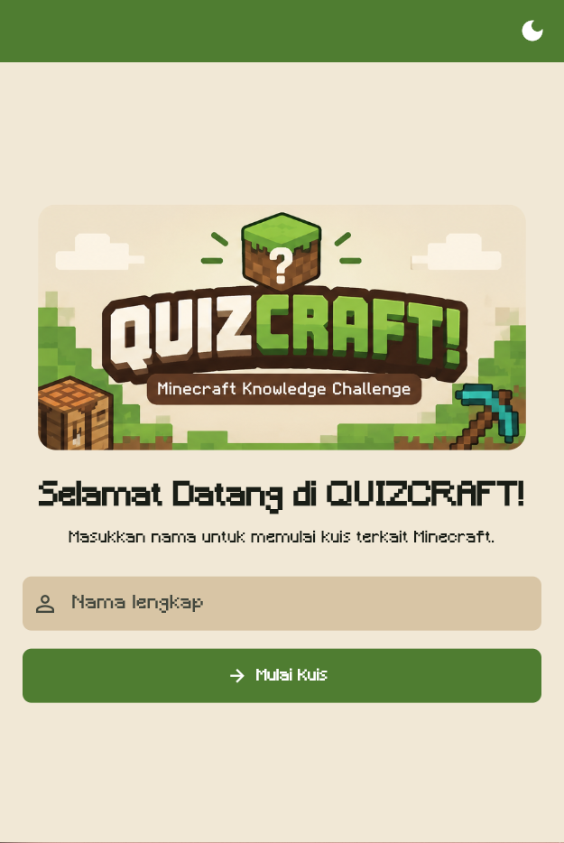
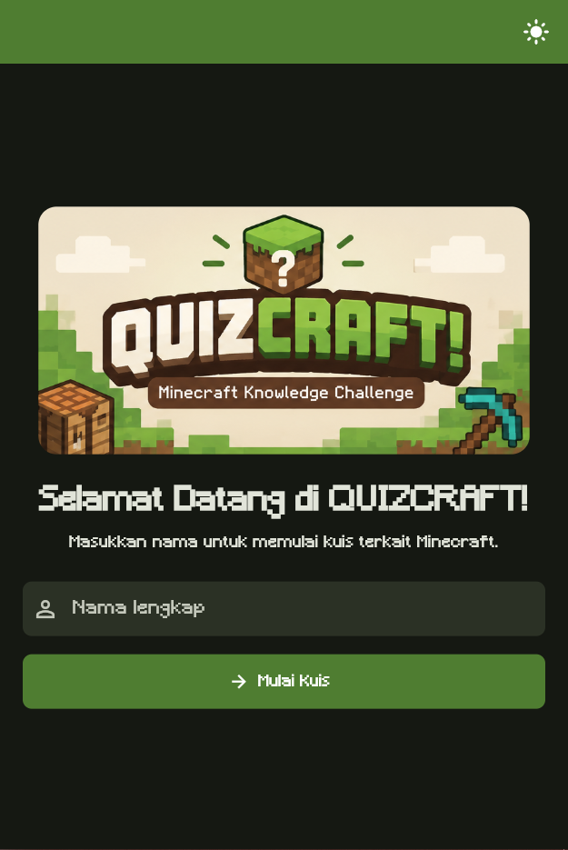
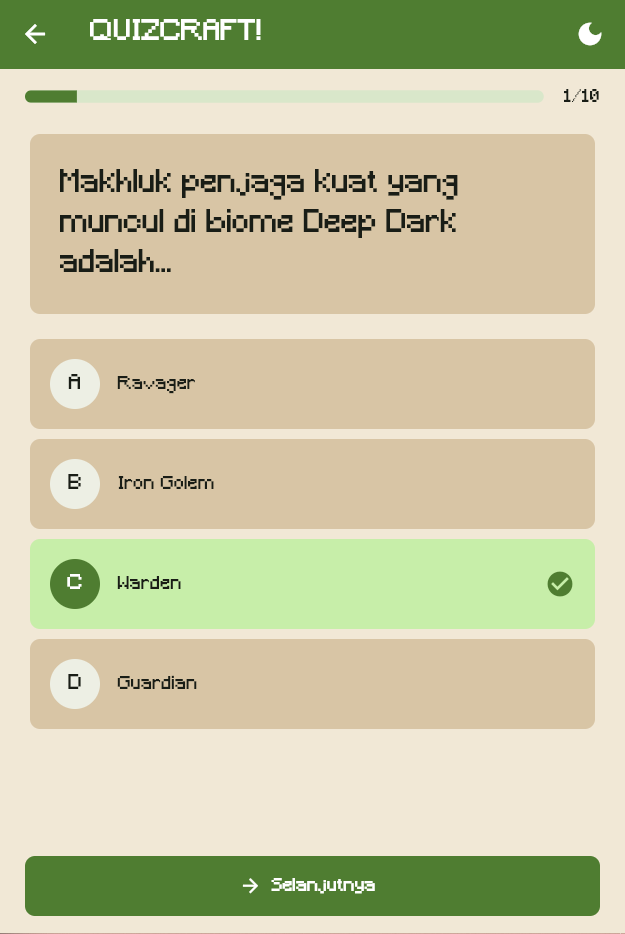
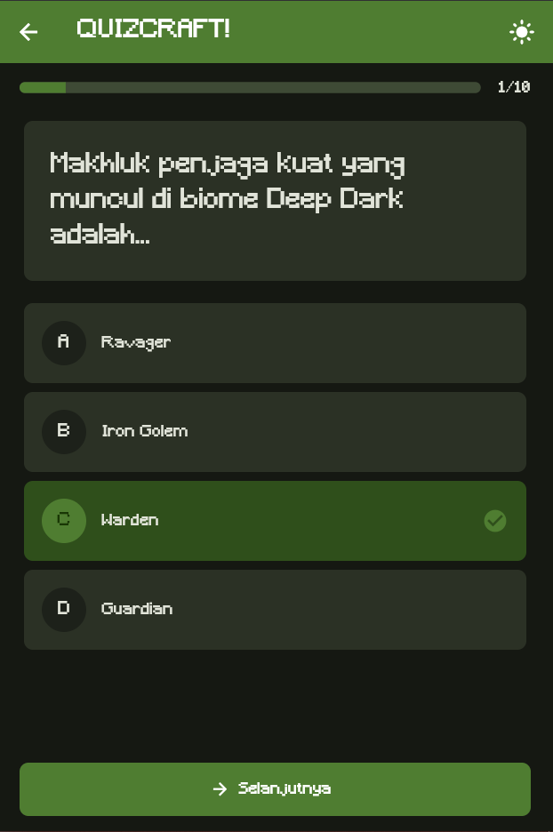
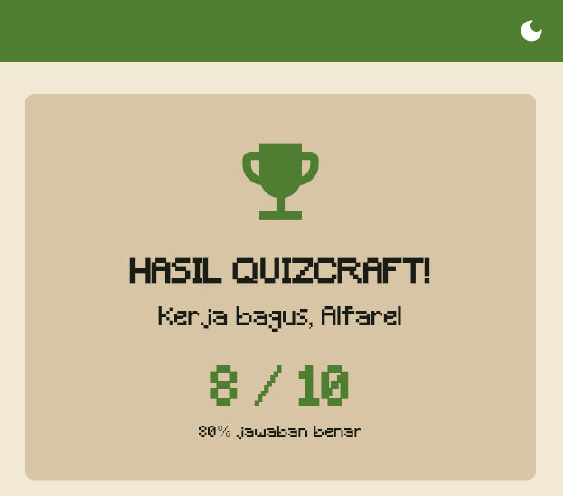
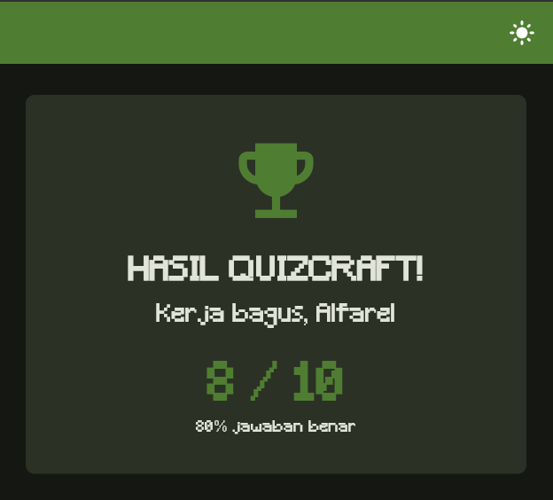
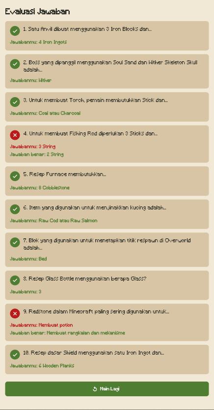
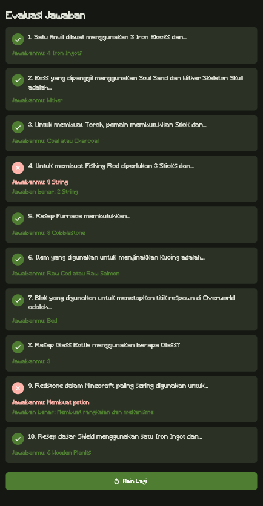
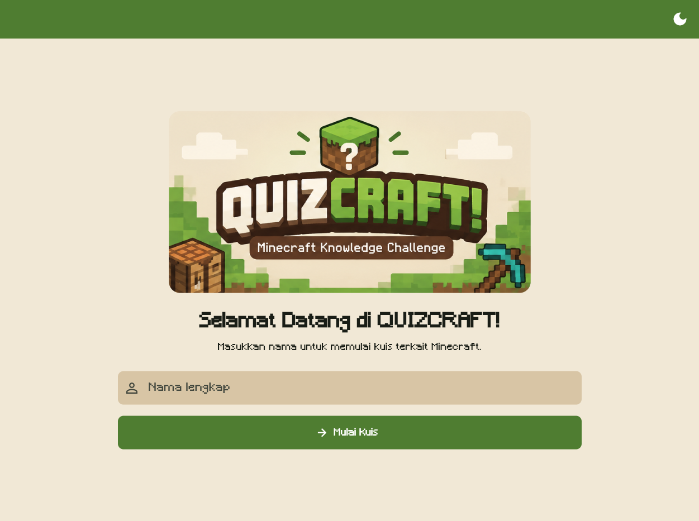
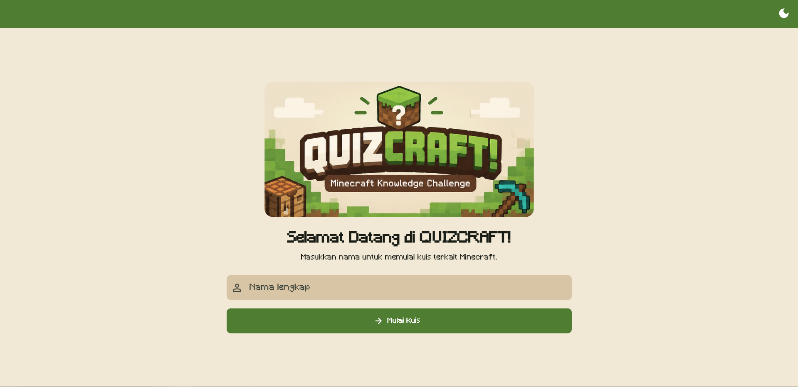

# QUIZCRAFT!

## A. Identitas Mahasiswa

1. **Nama:** Muhammad Al Farel Azhar
2. **NIM:** 241401009
3. **Lab:** Pemrograman Mobile 5

## B. Informasi Aplikasi

### 1. Nama Aplikasi

**QUIZCRAFT! - Minecraft Knowledge Challenge**

### 2. Deskripsi Singkat Aplikasi

QUIZCRAFT! adalah aplikasi kuis pilihan ganda berbasis Flutter untuk menguji pengetahuan pemain tentang Minecraft. Materinya mencakup resep crafting dan pengetahuan umum Minecraft. Setiap sesi berisi 10 soal yang dipilih secara acak dari bank soal lokal, sehingga soal berubah saat pemain mengulangi kuis.

Aplikasi menggunakan Provider untuk mengelola nama pemain, progres, jawaban, skor, tema, dan evaluasi hasil. Antarmukanya responsif untuk ponsel, tablet, dan web serta menyediakan mode terang dan gelap.

### 3. Fitur-fitur yang Tersedia

- Input dan validasi nama pemain.
- Bank soal crafting recipe dan pengetahuan umum Minecraft.
- Sepuluh soal acak pada setiap percobaan.
- Navigasi ke soal sebelum dan berikutnya.
- Penyimpanan pilihan jawaban selama sesi berlangsung.
- Indikator progres kuis.
- Perhitungan skor dan persentase jawaban benar.
- Evaluasi semua soal pada halaman hasil.
- Penanda jawaban benar dan salah.
- Tampilan jawaban yang benar ketika pemain menjawab salah.
- Tombol main lagi untuk memperoleh susunan soal baru.
- Light mode dan dark mode.
- Desain adaptif untuk ponsel, tablet, dan web.
- State management menggunakan Provider.
- Font Minecraft lokal, banner, dan launcher icon kustom.

## C. Dokumentasi

### 1. Credit Sumber Aset

- Font `Minecraft.ttf` diunduh dari [Minecraft Font - DaFont](https://www.dafont.com/minecraft.font). Hak cipta dan ketentuan penggunaan mengikuti informasi lisensi pada halaman atau berkas font tersebut.
- Banner `assets/images/banner.png` dan ikon `assets/images/icon.png` disediakan oleh pembuat proyek berdasarkan konsep visual QUIZCRAFT!.
- Ikon antarmuka menggunakan Material Icons bawaan Flutter.
- Minecraft adalah merek dagang milik Mojang Studios/Microsoft. Proyek pembelajaran ini tidak resmi dan tidak berafiliasi dengan Mojang Studios atau Microsoft.

### 2. Screenshot Tiap Page Aplikasi

Buat folder `docs/screenshots/`, kemudian tambahkan:

1. `welcome.png` - halaman welcome.
<table border="0">
  <tr>
    <td align="center">
      <b>Welcome - Light Mode</b><br/>
      
    </td>
    <td align="center">
      <b>Welcome - Dark mode</b><br/>
      
    </td>
  </tr>
</table>

2. `quiz.png` - halaman kuis ketika jawaban dipilih.
<table border="0">
  <tr>
    <td align="center">
      <b>Quiz - Light Mode</b><br/>
      
    </td>
    <td align="center">
      <b>Quiz - Dark mode</b><br/>
      
    </td>
  </tr>
</table>

3. `result.png` - ringkasan skor akhir.
<table border="0">
  <tr>
    <td align="center">
      <b>Result - Light Mode</b><br/>
      
    </td>
    <td align="center">
      <b>Result - Dark mode</b><br/>
      
    </td>
  </tr>
</table>

4. `evaluation.png` - daftar evaluasi jawaban benar dan salah.
<table border="0">
  <tr>
    <td align="center">
      <b>Eval - Light Mode</b><br/>
      
    </td>
    <td align="center">
      <b>Eval - Dark mode</b><br/>
      
    </td>
  </tr>
</table>

5. `responsive-tablet-web.png` - tampilan tablet atau browser.
<table border="0">
  <tr>
    <td align="center">
      <b>Tablet Mode</b><br/>
      
    </td>
    <td align="center">
      <b>Web Mode</b><br/>
      
    </td>
  </tr>
</table>

### 3. Link Mockup/Prototype Aplikasi

Mockup dibuat dengan menggunakan figma:

```text
Welcome -> Quiz -> Result dan Evaluasi -> Kembali ke Welcome
```

```text
Link mockup/prototype: https://www.figma.com/design/5DJRmVDENYHdn5nuMB1fRD/UTS_PM5_Alfarel_009?node-id=1-2&t=SzZJwGhq6Zp6cjvA-1
```

## Konfigurasi Font Minecraft

Font sudah diletakkan di:

```text
assets/fonts/Minecraft.ttf
```

Font didaftarkan dalam `pubspec.yaml`:

```yaml
flutter:
  fonts:
    - family: MinecraftFont
      fonts:
        - asset: assets/fonts/Minecraft.ttf
```

Kemudian digunakan secara global pada `lib/theme/app_theme.dart`:

```dart
fontFamily: 'MinecraftFont',
```

Jika font tidak langsung berubah setelah hot reload, hentikan aplikasi lalu jalankan:

```bash
flutter clean
flutter pub get
flutter run
```

## Menjalankan dan Menguji Aplikasi

```bash
flutter pub get
flutter run
flutter analyze
flutter test
```
